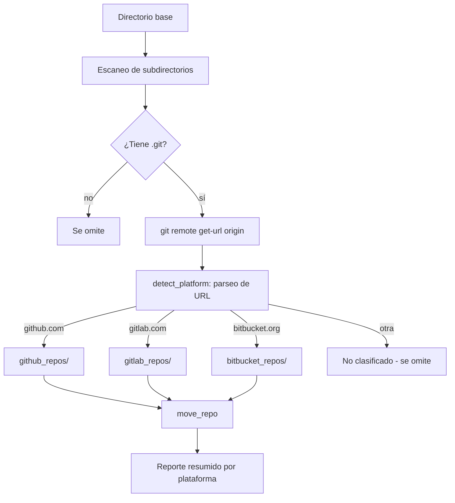

# github-repo-discovery

Escanea directorios en busca de repositorios Git, detecta su plataforma de hosting (GitHub, GitLab, Bitbucket) y los organiza en subdirectorios por plataforma.

[](https://python.org)
[](https://github.com/bi0punk/github-repo-discovery/actions)
[](LICENSE)

## Contenido

- [Características](#características)
- [Arquitectura](#arquitectura)
- [Stack](#stack)
- [Estructura del repositorio](#estructura-del-repositorio)
- [Instalación](#instalación)
- [Uso](#uso)
- [Opciones](#opciones)
- [Tests / CI](#tests--ci)
- [Limitaciones](#limitaciones)
- [Licencia](#licencia)

## Características

- Escaneo recursivo o de nivel superior buscando directorios `.git`
- Detecta el remote `origin` apuntando a GitHub, GitLab o Bitbucket
- Parseo correcto de URLs para evitar falsos positivos (p.ej. `notgithub.com`)
- Mueve repos a carpetas por plataforma: `github_repos/`, `gitlab_repos/`, `bitbucket_repos/`
- Modo `--dry-run` para previsualizar cambios sin mover nada
- Protección de rutas críticas del sistema con prompt de confirmación
- Reporte resumido con estadísticas por plataforma
- Cero dependencias de runtime (solo librería estándar de Python)
- Instalable como comando CLI vía `pip install`

## Arquitectura



## Stack

| Componente | Tecnología |
|---|---|
| Lenguaje | Python 3.11+ (solo stdlib) |
| CLI | argparse + entry point en `pyproject.toml` |
| Detección | `git remote get-url origin` + `urllib.parse` |
| Testing | pytest + pytest-cov |
| CI | Ruff lint + pytest con cobertura |

## Estructura del repositorio

```
github-repo-discovery/
├── src/
│   └── github_repo_discovery/
│       ├── __init__.py
│       ├── __main__.py
│       └── cli.py              # CLI entry point y lógica central
├── tests/
│   └── test_app.py             # 41 unit tests
├── .github/
│   └── workflows/
│       └── ci.yml              # CI: Ruff lint + pytest con cobertura
├── pyproject.toml              # Config del proyecto, deps, entry points
├── .python-version             # Python version pin
├── .env.example
├── LICENSE                     # MIT
└── README.md
```

## Instalación

```bash
pip install git+https://github.com/bi0punk/github-repo-discovery.git
```

O para desarrollo:

```bash
git clone https://github.com/bi0punk/github-repo-discovery.git
cd github-repo-discovery
uv sync --all-extras
```

## Uso

```bash
github-repo-discovery /path/to/scan

# Dry-run: solo previsualiza, no mueve nada
github-repo-discovery /path/to/scan --dry-run

# Escaneo recursivo
github-repo-discovery /path/to/scan --recursive

# Solo plataformas específicas
github-repo-discovery /path/to/scan --platforms github.com,gitlab.com

# Salida verbose
github-repo-discovery /path/to/scan -v

# Como módulo de Python
python -m github_repo_discovery /path/to/scan --dry-run
```

### Ejemplo de salida

```
INFO  [DIR] my-project
INFO    Remote: https://github.com/user/my-project.git
INFO    Platform: github.com
INFO    Moved to: /home/user/projects/github_repos/my-project

INFO  [DIR] another-repo
INFO    Remote: https://gitlab.com/group/repo.git
INFO    Platform: gitlab.com
INFO    Moved to: /home/user/projects/gitlab_repos/another-repo

========================================
SUMMARY
========================================
Directories scanned: ~10
Git repositories:    5
  github.com: 3
  gitlab.com: 2
Repos moved: 5
Base directory: /home/user/projects
```

## Opciones

| Flag | Descripción |
|---|---|
| `--dry-run` | Reporta lo que se movería sin mover nada |
| `--recursive` | Recorre subdirectorios (default: solo nivel superior) |
| `--platforms` | Dominios a detectar separados por coma (default: `github.com,gitlab.com,bitbucket.org`) |
| `--verbose`, `-v` | Habilita logging de nivel debug |
| `--help`, `-h` | Muestra ayuda |

## Tests / CI

CI: GitHub Actions ejecuta Ruff lint + pytest con cobertura en cada push/PR.

```bash
uv sync --all-extras
uv run pytest -v
uv run pytest --cov=src --cov-report=term-missing
```

## Limitaciones

- Solo escanea el remote `origin` (no otros remotes)
- No maneja submódulos de Git
- No preserva atributos extendidos de archivo
- URLs de Git estilo shell (`git@github.com:user/repo.git`) se soportan vía parseo SSH

## Licencia

MIT — ver [LICENSE](LICENSE).